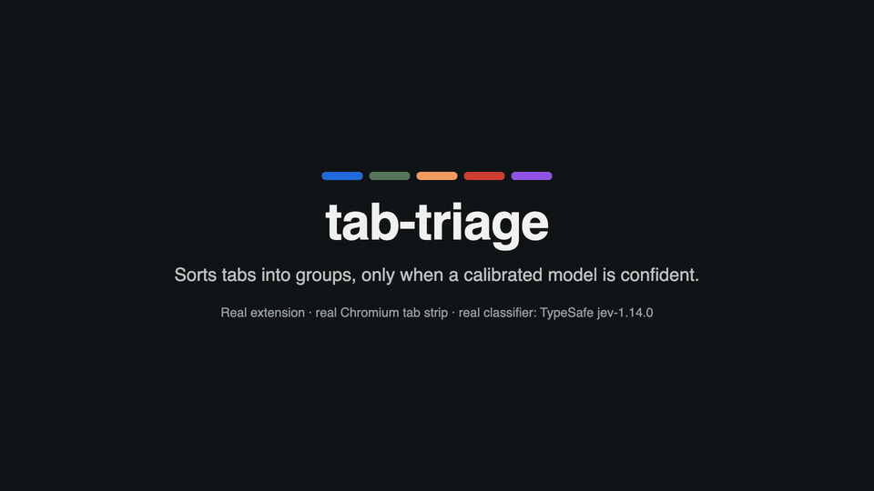

# tab-triage

A Chrome extension that sorts the tabs in the current window into Chrome tab groups. It only moves a tab when the classifier is confident; the rest stay where they are. **Undo** puts everything back.



**Install:** [tab-triage-pi.vercel.app/install](https://tab-triage-pi.vercel.app/install). No account or API key needed.

## How it works

1. Skip tabs that are pinned, already grouped, incognito, `chrome://`, local, or on the user's blocklist.
2. Match the user's domain rules locally (e.g. `arxiv.org` → Research). No network call.
3. For the rest, send one request per tab with two questions: a **Choice** (which group?) and a **Noul** (does any group fit at all?).
4. Group the tab only if both probabilities are at least the threshold (default 0.8). If it's within 0.1 of the threshold, ask again with the options reversed and group it only if the answer doesn't change. This guards against the model favouring the first option.
5. Classify every tab first, then move them. If anything fails, no tab moves. Undo restores the saved snapshot.

Only the hostname and the first 120 characters of the title leave the browser. They go to a small hosted service (`proxy/`), which holds the [TypeSafe](https://docs.typesafe.ai) API key and forwards the request. Nothing is logged or stored there. See the [privacy policy](https://tab-triage-pi.vercel.app/privacy).

## Project layout

```
src/core/        pure logic: privacy filter, decision rule, cache, pipeline, snapshot/undo
src/providers/   classifiers: hosted service (default), direct TypeSafe, mock
src/browser/     the only code that calls chrome.tabs / chrome.tabGroups
src/popup/, src/options/, src/background.ts
proxy/           the hosted service (Vercel Edge Function), see proxy/README.md
site/            landing, install and privacy pages served by the same Vercel project
test/            Vitest unit tests; test/e2e is a real-Chromium smoke test
eval/            label your own tabs and measure accuracy and calibration
demo/            records demo/demo.gif from a real screen capture
store/           Chrome Web Store listing text and images
```

## Development

```bash
npm ci
```

```bash
npm run build      # dist/ → chrome://extensions → Developer mode → Load unpacked
npm test           # unit tests
npm run test:e2e   # real Chromium, mock classifier, no network
npm run typecheck
```

Options → Mock mode switches to a keyword matcher, so no API calls are made (dev builds only).

To point the extension at a local or staging service, build with `TAB_TRIAGE_SERVICE=http://localhost:8787 npm run build`. Running the service locally is covered in [proxy/README.md](proxy/README.md).

## Scripts that call TypeSafe directly

These read `TYPESAFE_API_KEY` from the environment or a gitignored `.env`.

| Command | What it does |
| - | - |
| `npm run probe` | 13 requests on public pages, to check the API end to end |
| `npm run eval:label` | writes `eval/labeled.json` from your open tabs, for you to label |
| `npm run eval` | accuracy and coverage per threshold, plus reliability bins (`eval/results/`). Refuses to run over `--max-calls`, default 100 |
| `npm run demo` | records the demo GIF (macOS needs Screen Recording permission) |

## Releasing

`npm run package` writes two zips to `release/`:

- `tab-triage-<version>.zip` for the Chrome Web Store. Listing text is in `store/listing.md`.
- `-download.zip` for the website install. It carries a manifest `key` that fixes the extension id; never upload it to the store.

The Vercel project redeploys the service and the site on every push to `main`.

## License

MIT
